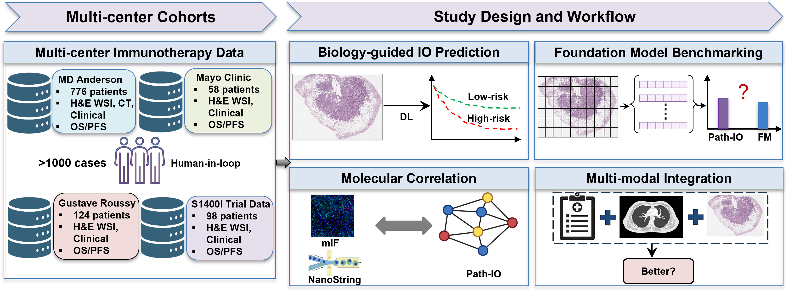

# Path-IO

**Pathology-Driven Immunotherapy Optimization**

[](https://doi.org/10.5281/zenodo.24408066)

Path-IO is a computational pathology framework for survival risk prediction in patients with metastatic non–small cell lung cancer (NSCLC) treated with immune checkpoint inhibitors.

This repository provides the **source code and a TCGA-LUAD/LUSC inference tutorial**. Pretrained model weights are archived separately on Zenodo under controlled access.

## Path-IO Pipeline

<p align="center">
  
</p>

<p align="center">
  <em>Overview of the Path-IO computational framework and study workflow.</em>
</p>

## Computational Workflow

1. **WSI patch extraction and habitat mapping** — UNI feature extraction, eight-class tissue classification (background, bronchi, inflammatory/immune, normal, necrosis, stroma, tumor, vessel) and habitat map reconstruction.

2. **WSI map preprocessing** — Patient-level tissue packing and seven-channel one-hot habitat patch extraction (64 × 64 pixels, stride 32).

3. **Survival prediction** — Four pretrained convolutional neural network (CNN) architectures (ResNet18, ResNet34, ResNet50, and ResNeXt50) for patch-level risk prediction, followed by GFisher vector aggregation and a random survival forest (RSF) for patient-level continuous risk estimation.

4. **Multimodal integration** — A composite RSF model integrating Path-IO risk, CT-derived risk generated using the [Deep-CT prognostic model](https://github.com/WuLabMDA/Deep_CT-prognostic-biomarker), and clinical predictors.

5. **TCGA inference tutorial** — A notebook demonstrating TCGA-LUAD/LUSC image download, clinical data retrieval, model inference, and survival evaluation using the concordance index (C-index), continuous-risk Cox hazard ratios (HRs), 95% confidence intervals (CIs), and P-values.
## Repository Structure

```text
Path-IO-Framework/
├── README.md
├── Path-IO_pipeline.png
├── requirements.txt
├── .gitignore
├── 1.Patch_extraction_WSI_habitat_map_generation/
│   ├── patch_extraction/
│   ├── tissue_classification/
│   ├── inference/
│   └── habitat_map_generation/
├── 2.WSI_map_preprocessing/
│   ├── tissue_packing.py
│   └── generate_patches.py
├── 3.Survival_prediction/
│   ├── Macro_networks_new.py
│   ├── models.py
│   ├── common.py
│   ├── train_survival_models.py
│   ├── extract_patch_risks.py
│   ├── fisher_rsf.py
│   ├── train_fisher_rsf.py
│   ├── predict_fisher_rsf.py
│   └── weights/README.md
├── 4.Multimodal_integration/
│   ├── train_composite_model.py
│   ├── predict_composite_risk.py
│   └── weights/README.md
└── 5.TCGA_inference_tutorial/
    ├── PathIO_TCGA_LUAD_LUSC_End_to_End_Inference.ipynb
    ├── prepare_tcga_slides.py
    ├── infer_released_cnns.py
    └── checkpoints.example.csv
```

## Setup

Create a Python environment and install the required dependencies.

```bash
conda create -n pathio_env python=3.10 -y
conda activate pathio_env

# Install a compatible PyTorch build for your system first.
pip install -r requirements.txt
```

Refer to the individual module READMEs for detailed instructions on input preparation, preprocessing, model inference, and expected outputs.

The TCGA inference tutorial provides an example workflow. Native OpenSlide libraries and sufficient disk space are required for processing large whole-slide images.

## Pretrained Models — Controlled Access

The pretrained model weights associated with Path-IO are deposited on **Zenodo under restricted access** to support reproducible computational pathology research.

**Model repository:** [Path-IO Pretrained Models — Zenodo](https://doi.org/10.5281/zenodo.24408066)

The model collection includes:

- **Tissue classification:** UNI-based eight-class tissue classifier.
- **Deep learning survival models:** Pretrained ResNet18, ResNet34, ResNet50, and ResNeXt50 models for patch-level survival risk prediction.
- **Patient-level survival prediction:** Random survival forest (RSF) model for patient-level risk estimation.
- **Multimodal integration:** Composite survival model integrating CT-derived risk, Path-IO risk, and clinical predictors.

### Requesting Model Access

Researchers interested in obtaining the pretrained models can visit the [Zenodo record](https://doi.org/10.5281/zenodo.24408066) and select **Request access**.

Please provide:

- Name and institutional affiliation
- Institutional email address
- Brief description of the intended research use

Access requests will be reviewed individually in accordance with applicable institutional policies. Model files are not publicly downloadable.

Once access is approved, researchers can download the pretrained models and use them with the source code and inference tutorials provided in this repository.

## Deep-CT Risk Score for Multimodal Integration

The CT-derived risk scores used in the Path-IO multimodal framework were generated using the previously developed **Deep-CT prognostic model** for patients with NSCLC receiving immune checkpoint inhibitors.

Deep-CT is a separate computational imaging framework that generates patient-level survival risk scores from CT images.

Researchers interested in reproducing the multimodal analysis can use the Deep-CT implementation to generate CT-derived risk scores. These scores can subsequently be integrated with Path-IO risk scores and clinical variables using the multimodal integration module provided in this repository.

**Deep-CT source code:** [Deep-CT Prognostic Biomarker — GitHub](https://github.com/WuLabMDA/Deep_CT-prognostic-biomarker)

**Deep-CT publication:** [Original Deep-CT study](https://doi.org/10.1016/S2589-7500(23)00082-1)

Users of the Deep-CT model should cite the original publication and follow the instructions and applicable terms provided in its GitHub repository.

**Note:** This Path-IO repository does not include the Deep-CT model implementation or CT imaging datasets. CT-derived risk scores must be generated separately and supplied as inputs to the multimodal integration module.

## Research Use and Issues

Path-IO is intended for computational pathology research and methodological evaluation. It is not validated or approved for clinical decision-making.

The framework provides prognostic risk estimates and should not be interpreted as a validated predictor of differential benefit from specific immunotherapy regimens.

Patient-level research datasets are not publicly distributed through this repository.

For reproducible software issues, please use the [GitHub Issues page](https://github.com/WuLabMDA/Path-IO-Framework/issues).

## Citation and License

If you use Path-IO in your research, please cite the associated Path-IO manuscript when available.

**Path-IO pretrained models:**

[Path-IO: Pretrained Models for Computational Pathology Survival Prediction — Zenodo](https://doi.org/10.5281/zenodo.24408066)

If you use CT-derived risk scores generated using Deep-CT, please also cite the original Deep-CT publication:

[Deep-CT Prognostic Biomarker](https://doi.org/10.1016/S2589-7500(23)00082-1)

A repository license will be added following confirmation of institutional distribution terms. Third-party code, models, and datasets retain their respective terms.
